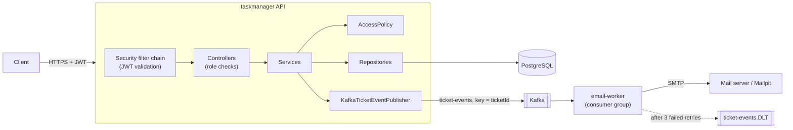
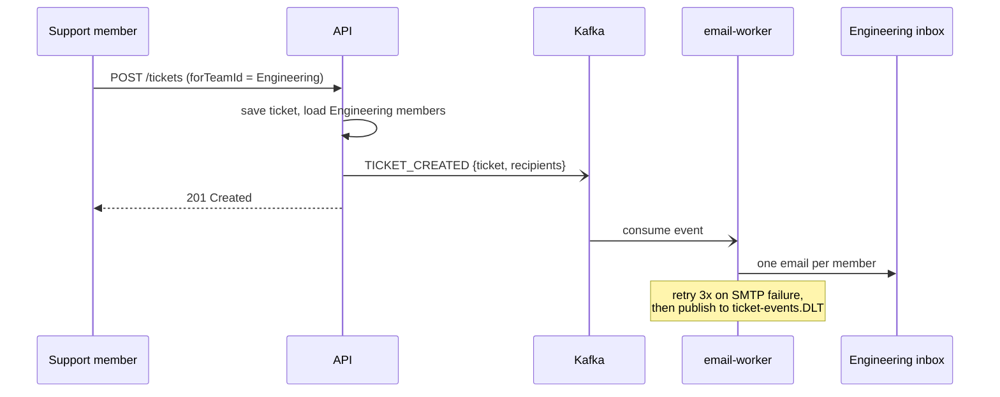
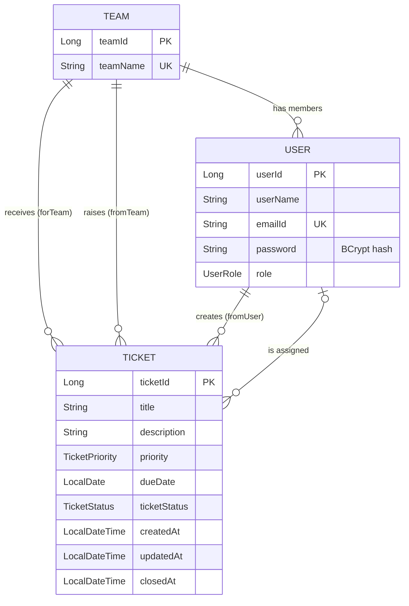

# Task Manager API

A ticketing backend where teams raise tickets for other teams, team admins assign them, and people are notified by email as tickets are created and resolved. It's built with **Spring Boot 4** and **Java 21**.

The system has two services connected through **Apache Kafka**:

- **`taskmanager` (the API):**
  - authenticates users with **JWT**;
  - enforces **role-based and team-based authorization**;
  - stores data in **PostgreSQL**;
  - publishes ticket events to Kafka.
- **`email-worker`:** consumes those events and sends the notification emails. It retries failed sends and puts messages that keep failing on a **dead-letter topic**.

The whole stack runs with one `docker compose up`, and every push is built and tested by **GitHub Actions**.

---

## Features

- **Authentication:** register and log in, then receive a signed HS256 JWT carrying the user id and role. Passwords are stored as BCrypt hashes. Every endpoint except `/auth/**` requires a token.
- **Authorization at two levels:**
  - **Role checks** with `@PreAuthorize`, for example only a `SysAdmin` can create teams or change roles.
  - **Data checks** in a dedicated `AccessPolicy` class, for example only the receiving team's `TeamAdmin` can assign a ticket, and only the assignee can close it. See [Authorization rules](#authorization-rules).
  - The ticket creator is always taken from the token, never from the request body.
- **Tickets:**
  - title, description, priority (`Low` / `Medium` / `High` / `Critical`) and due date
  - partial updates through `PATCH`
  - timestamps for creation, last update and closing
  - a computed `overdue` flag
- **Event-driven notifications:**
  - When a ticket is created, every member of the receiving team gets an email.
  - When a ticket is resolved, every member of the team that raised it gets an email.
- **Reliable consumption:**
  - The ticket id is the message key, so events for one ticket stay in order.
  - Failed sends are retried 3 times, then parked on `ticket-events.DLT`.
  - Malformed messages go to the dead-letter topic immediately.
  - Workers share a consumer group, so you can scale them horizontally.
- **Validation and consistent errors:**
  - Request bodies are checked with Jakarta Bean Validation.
  - A global handler maps domain and security exceptions to 400, 401, 403, 404 or 409, all with the same JSON body.
- **Tests:**
  - 90 unit tests in the API, covering services, the authorization policy, the Kafka publisher and JWT generation;
  - 7 in the email worker;
  - a Spring context-load test run in CI against a real Postgres.

## Tech Stack

| Area | Technology |
|---|---|
| Language | Java 21 |
| Framework | Spring Boot 4.1 (Web MVC, Data JPA, Bean Validation) |
| Security | Spring Security 7, OAuth2 Resource Server (Nimbus JWT, HS256), BCrypt, method security |
| Messaging | Apache Kafka 3.9 (KRaft mode), Spring for Apache Kafka |
| Email | Spring Mail (SMTP); Mailpit as a local SMTP server with a web inbox |
| Database | PostgreSQL 17, Hibernate |
| Testing | JUnit 5, Mockito, AssertJ |
| DevOps | Docker (multi-stage builds), Docker Compose, GitHub Actions |
| Other | Maven, Lombok |

## Architecture



**Why a separate worker?** Sending email is slow and can fail. Publishing an event takes milliseconds, so the API responds immediately. The worker can be retried, scaled or redeployed without touching the API.

The event carries the recipients' addresses, so the worker never reads the API's database. The two services share only the JSON contract.

**Notification flow:**



### Domain model



## Authorization rules

**Roles:**
- **`Normal`:** a newly registered user with no team.
- **`Member`:** belongs to a team.
- **`TeamAdmin`:** manages a team.
- **`SysAdmin`:** manages everything and has no team.

Every rule that depends on data loads the caller fresh from the database, so a role or team change takes effect immediately.

| Action | Allowed for |
|---|---|
| Create a team, change a user's role, list all users or tickets | `SysAdmin` |
| Add a user to a team | `SysAdmin`, or a `TeamAdmin` adding a user with no team to their own team |
| Remove a user from a team | `SysAdmin`, or that team's `TeamAdmin` |
| Raise a ticket | Any user who belongs to a team (that team becomes the ticket's `fromTeam`) |
| View a ticket | `SysAdmin`, or a member of the team that raised or received it |
| View a team's tickets | `SysAdmin`, or a member of that team |
| View a user's assigned tickets | That user, their `TeamAdmin`, or a `SysAdmin` |
| Edit title, description, priority or due date | The creator, the receiving team's `TeamAdmin`, or a `SysAdmin` |
| Assign a ticket | The receiving team's `TeamAdmin`, or a `SysAdmin`. The assignee must belong to the receiving team. |
| Mark a ticket `Done` | Only the assigned user |
| Other status changes | The assignee, the receiving team's `TeamAdmin`, or a `SysAdmin` |

## Getting Started

### Option 1: Run the whole stack with Docker (recommended)

You only need Docker.

```bash
cp .env.example .env          # then set JWT_SECRET (openssl rand -base64 32)
docker compose up --build
```

| Service | URL |
|---|---|
| API | http://localhost:8080 |
| Mailpit inbox (every email sent appears here) | http://localhost:8025 |
| Postgres | localhost:5432 |
| Kafka (from the host) | localhost:29092 |

The first `SysAdmin` is created from `BOOTSTRAP_ADMIN_EMAIL` and `BOOTSTRAP_ADMIN_PASSWORD` in `.env`. To run several email workers sharing the load:
```bash
docker compose up --scale email-worker=3
```

### Option 2: Run the API from your IDE

You need JDK 21 and PostgreSQL with a database named `taskmanager`. Create `src/main/resources/application-local.yml`, which is git-ignored:

```yaml
DB_IP: localhost
DB_PORT: 5432
DB_USERNAME: postgres
DB_PASSWORD: your-db-password
JWT_SECRET: your-base64-secret     # openssl rand -base64 32 (must decode to >= 32 bytes)
BOOTSTRAP_ADMIN_EMAIL: admin@example.com
BOOTSTRAP_ADMIN_PASSWORD: change-me-please
```

```bash
./mvnw spring-boot:run
```

Notifications are **off by default**: events are only logged, so you don't need Kafka. To turn them on, start the infrastructure with `docker compose up postgres kafka mailpit`, then set `NOTIFICATIONS_ENABLED=true` and run the worker too:

```bash
./mvnw -f email-worker/pom.xml spring-boot:run
```

### Configuration reference

| Variable | Used by | Default | Purpose |
|---|---|---|---|
| `DB_IP`, `DB_PORT`, `DB_USERNAME`, `DB_PASSWORD` | API | none | PostgreSQL connection |
| `JWT_SECRET` | API | none | Base64 HMAC key, at least 32 bytes |
| `NOTIFICATIONS_ENABLED` | API | `false` | Publish ticket events to Kafka |
| `KAFKA_BOOTSTRAP_SERVERS` | both | `localhost:29092` | Kafka broker |
| `TICKET_EVENTS_TOPIC` | both | `ticket-events` | Topic name |
| `BOOTSTRAP_ADMIN_EMAIL`, `BOOTSTRAP_ADMIN_PASSWORD` | API | empty | First `SysAdmin` account |
| `MAIL_HOST`, `MAIL_PORT` | worker | `localhost`, `1025` | SMTP server |
| `MAIL_USERNAME`, `MAIL_PASSWORD`, `MAIL_SMTP_AUTH`, `MAIL_STARTTLS` | worker | empty / `false` | Settings for a real SMTP provider |
| `MAIL_FROM` | worker | `taskmanager@example.com` | Sender address |

## API Reference

Every endpoint except `/auth/**` requires the header `Authorization: Bearer <token>`.

### Auth
| Method | Endpoint | Description |
|---|---|---|
| POST | `/auth/register` | Create an account (role `Normal`) |
| POST | `/auth/login` | Log in and receive a JWT |

### Users
| Method | Endpoint | Description |
|---|---|---|
| GET | `/users` | List all users (`SysAdmin`) |
| GET | `/users/{userId}` | Get one user |
| PATCH | `/users/{userId}/team` | Add the user to a team; they become a `Member` |
| PATCH | `/users/{userId}/role` | Change the user's role (`SysAdmin`) |
| PATCH | `/users/{userId}/team/remove` | Remove the user from their team |

### Teams
| Method | Endpoint | Description |
|---|---|---|
| GET | `/teams` | List teams with their members |
| GET | `/teams/{teamId}` | Get one team |
| GET | `/teams/{teamId}/users` | List the team's members |
| POST | `/teams` | Create a team (`SysAdmin`) |

### Tickets
| Method | Endpoint | Description |
|---|---|---|
| GET | `/tickets` | List all tickets (`SysAdmin`) |
| GET | `/tickets/{ticketId}` | Get one ticket |
| GET | `/tickets/team/{teamId}` | Tickets raised for a team, oldest first |
| GET | `/tickets/user/{userId}` | Tickets assigned to a user, oldest first |
| POST | `/tickets` | Raise a ticket (sends `TICKET_CREATED`) |
| PATCH | `/tickets/{ticketId}` | Update title, description, priority or due date |
| PATCH | `/tickets/{ticketId}/assign` | Assign the ticket to a member of the receiving team |
| PATCH | `/tickets/{ticketId}/status` | Change the status. Moving to `Done` sets `closedAt` and sends `TICKET_RESOLVED`. |

### Example flow

**1. Log in as the bootstrap admin, then create two teams:**
```http
POST /auth/login
Content-Type: application/json

{ "emailId": "admin@example.com", "password": "change-me-please" }
```
```json
{ "accessToken": "eyJhbGciOiJIUzI1NiJ9...", "tokenType": "Bearer", "expiresIn": 3600 }
```
```http
POST /teams
Authorization: Bearer <admin token>
Content-Type: application/json

{ "teamName": "Engineering" }
```
Repeat for `Support`.

**2. Register users and put them in teams:**
- Register users with `POST /auth/register`.
- As the admin, add them to teams with `PATCH /users/{id}/team`, sending `{ "newTeamId": 1 }`.
- Promote one Engineering user with `PATCH /users/{id}/role`, sending `{ "newRole": "TeamAdmin" }`.

**3. Raise a ticket as a Support member.** The creator and their team come from the token:
```http
POST /tickets
Authorization: Bearer <support member token>
Content-Type: application/json

{
  "title": "Login page returns 500",
  "description": "Happens on submit for SSO users",
  "priority": "High",
  "dueDate": "2026-10-30",
  "forTeamId": 1
}
```
```json
{
  "ticketId": 1,
  "title": "Login page returns 500",
  "priority": "High",
  "dueDate": "2026-10-30",
  "overdue": false,
  "forTeam":  { "teamId": 1, "teamName": "Engineering" },
  "fromTeam": { "teamId": 2, "teamName": "Support" },
  "fromUser": { "userId": 3, "userName": "alice", "emailId": "alice@example.com", "role": "Member" },
  "assignedUser": null,
  "ticketStatus": "Created",
  "createdAt": "2026-10-14T10:15:30",
  "updatedAt": "2026-10-14T10:15:30",
  "closedAt": null
}
```
Every Engineering member now has an email in Mailpit.

**4. Assign and resolve the ticket:**
- The Engineering `TeamAdmin` assigns it with `PATCH /tickets/1/assign`, sending `{ "assignedUserId": 4 }`.
- The assignee closes it with `PATCH /tickets/1/status`, sending `{ "ticketStatus": "Done" }`.
- Support then receives the "Resolved" email.

### Error format

```json
{ "status": 403, "message": "Only the assigned user can mark a ticket as Done", "timestamp": "2026-10-14T10:20:00" }
```
Validation errors return a map from each field to its message instead, for example `{ "title": "Must Provide a Title" }`.

| Status | When |
|---|---|
| 400 | Invalid body, failed validation, an unknown enum value, or assigning outside the receiving team |
| 401 | Wrong email or password, or a missing, invalid or expired token |
| 403 | Authenticated, but not allowed to do this |
| 404 | User, team, ticket or role not found |
| 409 | Duplicate email, or a duplicate team or role assignment |

## Testing

```bash
./mvnw test                              # API: 90 unit tests + context load (needs Postgres)
./mvnw -f email-worker/pom.xml test      # email worker: 7 unit tests
```

| Test class | Covers |
|---|---|
| `AccessPolicyTest` | Every authorization rule, with both allowed and forbidden cases (33 tests) |
| `TicketServiceTest` | Creator taken from the token, assignment validation, `closedAt` and `overdue`, events published only on real transitions |
| `UserServiceTest` | Role transitions, team membership, login with wrong email or wrong password |
| `KafkaTicketEventPublisherTest` | Payload shape, ticket-id key, recipients per event, never throws when Kafka is down |
| `TokenServiceTest` | A JWT encoded and decoded again keeps its subject, role and expiry |
| `TicketEventListenerTest` / `EmailComposerTest` | One email per recipient, subjects and bodies, malformed JSON and SMTP failures propagate for retry or the DLT |

## CI/CD

The workflow `.github/workflows/ci.yml` runs on every push and pull request:
1. **Backend:** builds and runs all tests with JDK 21, with a Postgres service container for the context-load test.
2. **Email worker:** builds and runs its tests.
3. **Docker:** once both pass, builds both images with `docker compose build`.

## Project Structure

```
.
├── src/main/java/com/example/taskmanager
│   ├── config/        # SecurityConfig, JWT encoder/decoder, password encoder, Kafka topic, admin bootstrap
│   ├── controller/    # REST endpoints (Auth, User, Team, Ticket) with @PreAuthorize
│   ├── dto/           # Validated request bodies and response shapes
│   ├── entities/      # JPA entities (User, Team, Ticket)
│   ├── enums/         # UserRole, TicketStatus, TicketPriority
│   ├── events/        # Ticket event contract and Kafka / logging publishers
│   ├── exceptions/    # Domain exceptions and GlobalExceptionHandler
│   ├── mappers/       # Entity <-> DTO conversion
│   ├── repository/    # Spring Data JPA repositories
│   ├── security/      # AccessPolicy (data-level authorization), CurrentUser
│   └── services/      # Business logic, TokenService
├── email-worker/      # Separate Spring Boot service: Kafka consumer, email composer, DLT config
├── Dockerfile         # Multi-stage build for the API
├── docker-compose.yml # API + worker + Postgres + Kafka + Mailpit
└── .github/workflows/ci.yml
```

## Roadmap

- [ ] Transactional outbox, so an event is never lost if the API crashes between saving the ticket and publishing
- [ ] Flyway database migrations, replacing `ddl-auto`
- [ ] Integration tests with Testcontainers (Postgres and Kafka) and MockMvc security tests
- [ ] Pagination and filtering for ticket lists
- [ ] OpenAPI / Swagger UI documentation
- [ ] Refresh tokens and token revocation
